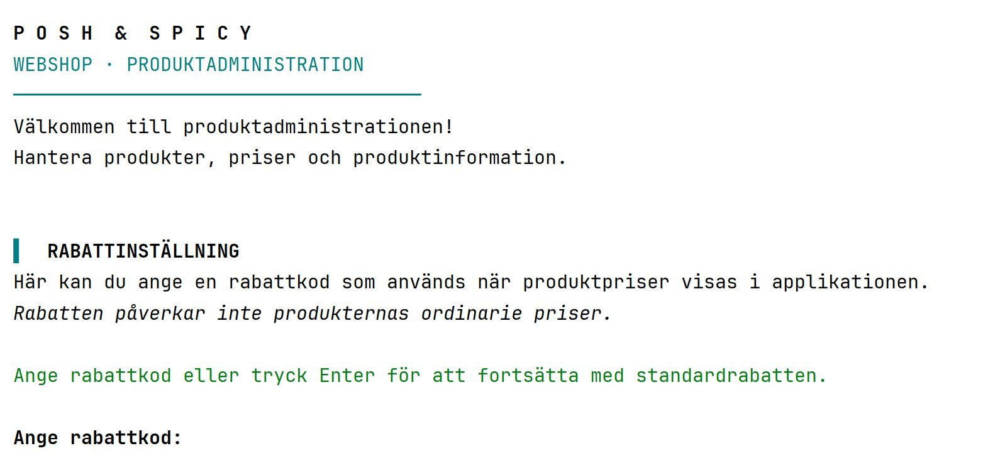
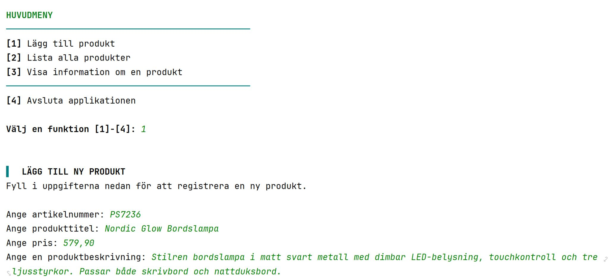
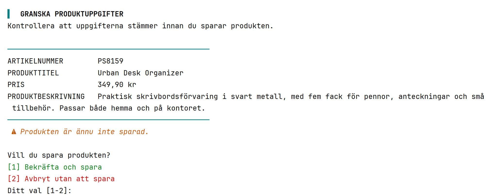

# POSH & SPICY 🛍️
### Java Console-Based Webshop Administration

POSH & SPICY is a console-based product administration application developed as part of my Java developer studies at IT-Högskolan in Sweden.

The application allows users to register products, view stored product information, search for products by article number, and display prices with discounts.

The project focuses on applying **object-oriented programming, interfaces, dependency injection, file handling, exception handling, and unit testing** in a practical Java application.

## Features

- **Product registration** – Add products with an article number, title, price, and description.
- **Input validation** – Prevent empty required fields, duplicate article numbers, invalid prices, and certain unsupported characters.
- **Product review** – Review entered information before confirming or canceling registration.
- **File-based storage** – Save products to a local `products.txt` file.
- **Product overview** – Display all registered products.
- **Product search** – Find individual products using their article numbers.
- **Discount calculations** – Apply a 50% discount using the `halfprice` code, or use the default 10% discount.
- **Error handling** – Handle invalid product data and file I/O errors.
- **Console formatting** – Use ANSI escape codes for colored text and formatted messages.

## Technologies

| Technology | Purpose |
|---|---|
| Java 26 | Application development |
| Maven | Project configuration and dependency management |
| JUnit Jupiter 6 | Unit testing |
| Java NIO (`Files`, `Path`) | File operations |
| Java IO API | Console input and output |
| Git & GitHub | Version control |

## Application Architecture

The application separates responsibilities across several classes and interfaces.

### Application flow

**`Main`**

The application's entry point. It creates the storage and console handler objects, passes them to `WebShopManager`, and starts the application.

**`WebShopManager`**

Coordinates the main application workflow, including product registration, input validation, product display, discount selection, and communication with the storage layer.

### Product model

**`Product`**

Represents a product with an article number, title, price, and description. It also provides methods for converting products to and from the text format used in the storage file.

### Storage

**`ProductStorage`**

An interface defining methods for saving products, retrieving all products, and retrieving a product by article number.

**`ProductFileStorage`**

Implements `ProductStorage` and handles reading and writing product information using a local text file.

### User interaction

**`OutInputHandler`**

An interface defining the operations required for communicating with the user.

**`ConsoleOutInputHandler`**

Implements the interface for console-based input and output.

**`Ansi`**

Contains constants used for formatting console output.

### Discounts

**`Discount`**

An abstract class defining a shared structure for discount calculations.

**`HalfPriceDiscount`**

Calculates a 50% discount.

**`TenPercentDiscount`**

Calculates a 10% discount.

Both classes implement their own version of `calculatePrice()`.

## Object-Oriented Design

A central learning objective of this project was to understand how different Java classes can collaborate without becoming unnecessarily dependent on each other's implementations.

### Interfaces and dependency injection

`WebShopManager` receives its dependencies through its constructor:

```java
public WebShopManager(ProductStorage productStorage,
                      OutInputHandler outInputHandler) {
    this.productStorage = productStorage;
    this.outInputHandler = outInputHandler;
}
```

This allows the application to use different implementations of the same interfaces.

For example, the application uses `ProductFileStorage` for persistent storage, while the tests can use `ProductListStorage`, which stores products in memory.

### Polymorphism

The application uses an abstract `Discount` reference to work with different discount implementations.

Both `HalfPriceDiscount` and `TenPercentDiscount` provide their own calculation logic through the same `calculatePrice()` method.

### Separation of responsibilities

The code separates product data, storage, console communication, and application logic.

This makes individual parts easier to understand, maintain, and test.

## Running the Application

### Requirements

- JDK 26
- Maven
- A Java IDE such as IntelliJ IDEA, or a suitable Java command-line environment

### Getting started

Clone the repository:

```bash
git clone https://github.com/Karmatante/Webshop.git
cd Webshop
```

Open the project in IntelliJ IDEA and import it as a Maven project.

Run the `Main` class to start the console application.

The application uses `products.txt` in the working directory for persistent product storage.

## Testing

The project includes JUnit tests for product storage operations, product data parsing, and discount calculations.

The tests cover:

- Saving and retrieving products through `WebShopManager`
- Searching for existing and nonexistent article numbers
- Converting valid text records into `Product` objects
- Rejecting invalid product records
- Verifying 50% and 10% discount calculations

An in-memory `ProductListStorage` implementation is used in the manager tests to avoid depending on the filesystem.

The test suite can be run through IntelliJ IDEA or Maven:

```bash
mvn test
```

The current tests focus on selected methods and do not yet cover the complete interactive console workflow or all file I/O scenarios.

## What I Learned

This project gave me practical experience with several core Java concepts:

- Designing classes with separate responsibilities
- Understanding interfaces and concrete implementations
- Applying constructor-based dependency injection
- Using inheritance, abstract classes, and polymorphism
- Reading and writing structured text files
- Handling checked and unchecked exceptions
- Validating input and handling unexpected user choices
- Writing unit tests with JUnit
- Organizing a Java project using Maven

One particularly useful learning experience was seeing how interfaces and dependency injection make it possible to replace a real file-based storage implementation with an in-memory alternative for testing.

## Project Status

**Educational project – console-based application**

The current version provides product administration through the console. It is not an online store and does not include a graphical user interface.

Possible future improvements include expanded test coverage, more robust input validation, and a graphical interface.


## Screenshots

The screenshots below show the console-based application in action.







---

Developed as part of my Java developer education at **IT-Högskolan, Sweden**.

**GitHub:** [Karmatante](https://github.com/Karmatante)
